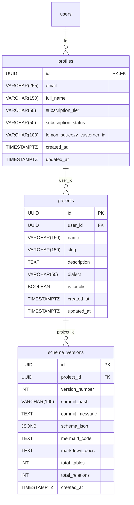

# 🗄️ Veritabanı Şema Dokümantasyonu

> **Motor (Dialect):** `PostgreSql`  
> **Toplam Tablo Sayısı:** `3`  
> **Oluşturulma Tarihi:** `2026-11-09 10:04:52 UTC`  
> *Bu dokümantasyon [SchemaFlow.ai](https://github.com) tarafından otomatik üretilmiştir.*

## 📑 İçindekiler
- [📊 İlişkisel ER Diyagramı](#-ilişkisel-er-diyagramı)
- [📋 Tablolar](#-tablolar)
  - [public.profiles](#profiles)
  - [public.projects](#projects)
  - [public.schema_versions](#schema_versions)

## 📊 İlişkisel ER Diyagramı

## 📋 Tablolar

### `public.profiles`
*Kullanıcı profilleri ve abonelik/fatura durumları*

#### Sütunlar
| Adı | Tipi | PK | Nullable | Varsayılan | Açıklama |
| :--- | :--- | :---: | :---: | :--- | :--- |
| **id** | `UUID` | ✅ | **Hayır** | — | — |
| **email** | `VARCHAR(255)` | — | **Hayır** | — | — |
| **full_name** | `VARCHAR(150)` | — | Evet | — | — |
| **subscription_tier** | `VARCHAR(50)` | — | Evet | `'free'` | — |
| **subscription_status** | `VARCHAR(50)` | — | Evet | `'active'` | — |
| **lemon_squeezy_customer_id** | `VARCHAR(100)` | — | Evet | — | — |
| **created_at** | `TIMESTAMPTZ` | — | Evet | `NOW()` | — |
| **updated_at** | `TIMESTAMPTZ` | — | Evet | `NOW()` | — |

#### İlişkiler (Foreign Keys)
| Kısıt Adı | Kolon | Hedef Tablo | Hedef Kolon | On Delete |
| :--- | :--- | :--- | :--- | :--- |
| `—` | `id` | [users](#users) | `id` | `CASCADE` |

---

### `public.projects`
*Kullanıcıların SchemaFlow üzerinde oluşturduğu projeler*

#### Sütunlar
| Adı | Tipi | PK | Nullable | Varsayılan | Açıklama |
| :--- | :--- | :---: | :---: | :--- | :--- |
| **id** | `UUID` | ✅ | **Hayır** | `gen_random_uuid()` | — |
| **user_id** | `UUID` | — | **Hayır** | — | — |
| **name** | `VARCHAR(150)` | — | **Hayır** | — | — |
| **slug** | `VARCHAR(150)` | — | **Hayır** | — | — |
| **description** | `TEXT` | — | Evet | — | — |
| **dialect** | `VARCHAR(50)` | — | Evet | `'postgres'` | — |
| **is_public** | `BOOLEAN` | — | Evet | `false` | — |
| **created_at** | `TIMESTAMPTZ` | — | Evet | `NOW()` | — |
| **updated_at** | `TIMESTAMPTZ` | — | Evet | `NOW()` | — |

#### İlişkiler (Foreign Keys)
| Kısıt Adı | Kolon | Hedef Tablo | Hedef Kolon | On Delete |
| :--- | :--- | :--- | :--- | :--- |
| `—` | `user_id` | [profiles](#profiles) | `id` | `CASCADE` |

#### İndeksler
| İndeks Adı | Kolonlar | Tekil (Unique)? | Filtre |
| :--- | :--- | :---: | :--- |
| `idx_projects_user_id` | `user_id` | — | — |

---

### `public.schema_versions`
*Projelerin zaman içindeki şema değişim geçmişi*

#### Sütunlar
| Adı | Tipi | PK | Nullable | Varsayılan | Açıklama |
| :--- | :--- | :---: | :---: | :--- | :--- |
| **id** | `UUID` | ✅ | **Hayır** | `gen_random_uuid()` | — |
| **project_id** | `UUID` | — | **Hayır** | — | — |
| **version_number** | `INT` | — | **Hayır** | `1` | — |
| **commit_hash** | `VARCHAR(100)` | — | Evet | — | — |
| **commit_message** | `TEXT` | — | Evet | — | — |
| **schema_json** | `JSONB` | — | **Hayır** | — | — |
| **mermaid_code** | `TEXT` | — | **Hayır** | — | — |
| **markdown_docs** | `TEXT` | — | **Hayır** | — | — |
| **total_tables** | `INT` | — | **Hayır** | `0` | — |
| **total_relations** | `INT` | — | **Hayır** | `0` | — |
| **created_at** | `TIMESTAMPTZ` | — | Evet | `NOW()` | — |

#### İlişkiler (Foreign Keys)
| Kısıt Adı | Kolon | Hedef Tablo | Hedef Kolon | On Delete |
| :--- | :--- | :--- | :--- | :--- |
| `—` | `project_id` | [projects](#projects) | `id` | `CASCADE` |

#### İndeksler
| İndeks Adı | Kolonlar | Tekil (Unique)? | Filtre |
| :--- | :--- | :---: | :--- |
| `idx_schema_versions_project_id` | `project_id` | — | — |
| `idx_schema_versions_created_at` | `created_at DESC` | — | — |

---