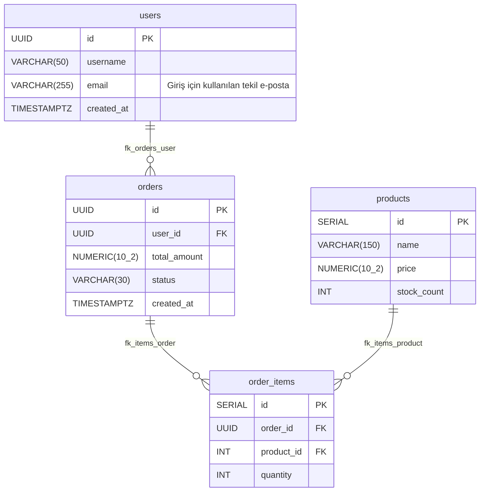

# 🛍️ TrendyShop API

TrendyShop, modern mikroservis mimarisine sahip bir e-ticaret platformudur.

## 🚀 Kurulum

```bash
dotnet restore
dotnet run
```

## 🗄️ Veritabanı Mimarisi

Aşağıdaki şema SchemaFlow.ai tarafından otomatik güncellenmektedir:

<!-- BEGIN_SCHEMAFLOW -->
# 🗄️ Veritabanı Şema Dokümantasyonu

> **Motor (Dialect):** `PostgreSql`  
> **Toplam Tablo Sayısı:** `4`  
> **Oluşturulma Tarihi:** `2026-11-09 09:23:48 UTC`  
> *Bu dokümantasyon [SchemaFlow.ai](https://github.com) tarafından otomatik üretilmiştir.*

## 📑 İçindekiler
- [📊 İlişkisel ER Diyagramı](#-ilişkisel-er-diyagramı)
- [📋 Tablolar](#-tablolar)
  - [public.users](#users)
  - [public.products](#products)
  - [public.orders](#orders)
  - [public.order_items](#order_items)

## 📊 İlişkisel ER Diyagramı


## 📋 Tablolar

### `public.users`
*Sisteme kayıtlı kullanıcı hesapları*

#### Sütunlar
| Adı | Tipi | PK | Nullable | Varsayılan | Açıklama |
| :--- | :--- | :---: | :---: | :--- | :--- |
| **id** | `UUID` | ✅ | **Hayır** | `gen_random_uuid()` | — |
| **username** | `VARCHAR(50)` | — | **Hayır** | — | — |
| **email** | `VARCHAR(255)` | — | **Hayır** | — | Giriş için kullanılan tekil e-posta |
| **created_at** | `TIMESTAMPTZ` | — | Evet | `NOW()` | — |

---

### `public.products`
#### Sütunlar
| Adı | Tipi | PK | Nullable | Varsayılan | Açıklama |
| :--- | :--- | :---: | :---: | :--- | :--- |
| **id** | `SERIAL` | ✅ | **Hayır** | — | — |
| **name** | `VARCHAR(150)` | — | **Hayır** | — | — |
| **price** | `NUMERIC(10, 2)` | — | **Hayır** | — | — |
| **stock_count** | `INT` | — | Evet | `0` | — |

---

### `public.orders`
#### Sütunlar
| Adı | Tipi | PK | Nullable | Varsayılan | Açıklama |
| :--- | :--- | :---: | :---: | :--- | :--- |
| **id** | `UUID` | ✅ | **Hayır** | — | — |
| **user_id** | `UUID` | — | **Hayır** | — | — |
| **total_amount** | `NUMERIC(10, 2)` | — | **Hayır** | — | — |
| **status** | `VARCHAR(30)` | — | Evet | `'pending'` | — |
| **created_at** | `TIMESTAMPTZ` | — | Evet | `NOW()` | — |

#### İlişkiler (Foreign Keys)
| Kısıt Adı | Kolon | Hedef Tablo | Hedef Kolon | On Delete |
| :--- | :--- | :--- | :--- | :--- |
| `fk_orders_user` | `user_id` | [users](#users) | `id` | `CASCADE` |

---

### `public.order_items`
#### Sütunlar
| Adı | Tipi | PK | Nullable | Varsayılan | Açıklama |
| :--- | :--- | :---: | :---: | :--- | :--- |
| **id** | `SERIAL` | ✅ | **Hayır** | — | — |
| **order_id** | `UUID` | — | **Hayır** | — | — |
| **product_id** | `INT` | — | **Hayır** | — | — |
| **quantity** | `INT` | — | Evet | `1` | — |

#### İlişkiler (Foreign Keys)
| Kısıt Adı | Kolon | Hedef Tablo | Hedef Kolon | On Delete |
| :--- | :--- | :--- | :--- | :--- |
| `fk_items_order` | `order_id` | [orders](#orders) | `id` | `CASCADE` |
| `fk_items_product` | `product_id` | [products](#products) | `id` | `NO ACTION` |

---
<!-- END_SCHEMAFLOW -->

## 📜 Lisans

MIT License © 2026 TrendyShop

