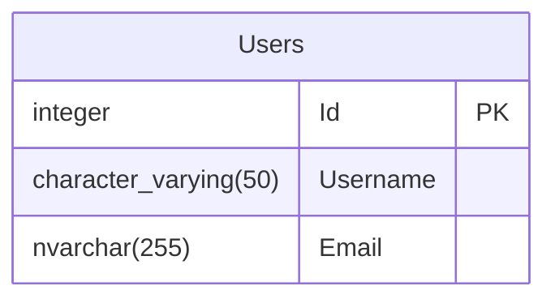
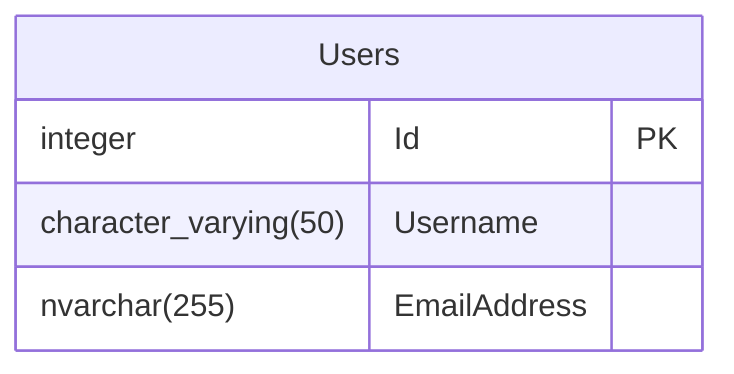

# 🔍 SchemaFlow Görsel Şema Değişiklik & Breaking Change Raporu

> **Temel Şema (Eski):** `20261115_BaseUsers.cs` (1 Tablo)  
> **Hedef Şema (Yeni):** `20261115_TargetMigration.cs` (1 Tablo)  
> **Tarih:** `2026-11-14 21:12:38 UTC`  

## ⚠️ DİKKAT: Canlı Sistemi Bozabilecek (Breaking) Değişiklikler!
- 🔴 **Kritik Değişiklik:** `1` adet (Canlıyı patlatabilir)
- 🟢 **Güvenli Değişiklik:** `1` adet

### 📋 Değişiklik Listesi (Öncesi ➡️ Sonrası)
| Durum | Değişiklik Türü | Tablo | Açıklama & Etki |
| :---: | :--- | :--- | :--- |
| 🔴 **BREAKING** | `ColumnDropped` | `Users` | 'Users' tablosundan 'Email' (nvarchar(255)) sütunu silindi! |
| 🟢 **SAFE** | `ColumnAdded` | `Users` | 'Users' tablosuna 'EmailAddress' (nvarchar(255)) sütunu eklendi. |

### 🔄 Sıfır Kesinti (Zero-Downtime) Expand & Contract Geçiş Planı
> ⚠️ **KRİTİK VERİ KAYBI UYARISI:** Aşağıdaki tablolarda sütun silinirken aynı anda yeni sütun eklendiği tespit edildi. Canlı veritabanındaki verilerin silinmesini önlemek için önerilen geçiş planı:

#### 📌 Tablo: `Users` (`Email` ➡️ `EmailAddress`)
- **Risk Gerekçesi:** 'Users' tablosunda 'Email' silinirken 'EmailAddress' eklenmiş. Bu bir kolon yeniden adlandırma veya refactoring ise, canlı sistemde veri kopyalanmadığı için 'Email' içindeki TÜM VERİLER KALICI OLARAK SİLİNECEKTİR!
- **Önerilen Geçiş Adımları:**
  - 1. Aşama (Expand): 'EmailAddress' sütununu nullable veya varsayılan değerle sisteme ekleyin.
  - 2. Aşama (Backfill): Mevcut verileri aktarın: UPDATE [Users] SET [EmailAddress] = [Email] WHERE [EmailAddress] IS NULL;
  - 3. Aşama (Migrate): Uygulamanızı yeni sütunu okuyup yazacak şekilde canlıya deploy edin.
  - 4. Aşama (Contract): Sonraki sürümde 'Email' sütununu güvenle Drop edin.
  - Hızlı Alternatif: Eğer kesintili bakım penceresi varsa 'migrationBuilder.RenameColumn(name: "Email", newName: "EmailAddress", table: "Users");' kullanabilirsiniz.
- **Örnek SQL Backfill Komutu:**
  ```sql
  UPDATE [Users] SET [EmailAddress] = [Email] WHERE [EmailAddress] IS NULL;
  ```


---
## 📊 Görsel Mimari Karşılaştırması (Before vs After)

### ⏪ 1. Eski Şema Hali (`20261115_BaseUsers.cs`)


### ⏩ 2. Yeni Şema Hali (`20261115_TargetMigration.cs`)


---
*Bu görsel rapor [SchemaFlow.ai](https://github.com/FiratMugdatoglu/SchemaFlow) tarafından otomatik oluşturulmuştur.*
