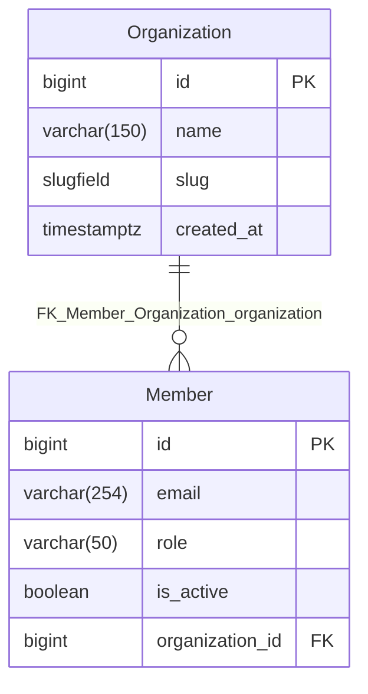

# 🗄️ Veritabanı Şema Dokümantasyonu

> **Motor (Dialect):** `Django`  
> **Toplam Tablo Sayısı:** `2`  
> **Oluşturulma Tarihi:** `2026-11-09 14:18:04 UTC`  
> *Bu dokümantasyon [SchemaFlow.ai](https://github.com) tarafından otomatik üretilmiştir.*

## 📑 İçindekiler
- [📊 İlişkisel ER Diyagramı](#-ilişkisel-er-diyagramı)
- [📋 Tablolar](#-tablolar)
  - [Organization](#organization)
  - [Member](#member)

## 📊 İlişkisel ER Diyagramı

## 📋 Tablolar

### `Organization`
*Django Model*

#### Sütunlar
| Adı | Tipi | PK | Nullable | Varsayılan | Açıklama |
| :--- | :--- | :---: | :---: | :--- | :--- |
| **id** | `bigint` | ✅ | **Hayır** | — | — |
| **name** | `varchar(150)` | — | **Hayır** | — | — |
| **slug** | `slugfield` | — | **Hayır** | — | — |
| **created_at** | `timestamp with time zone` | — | **Hayır** | — | — |

#### İndeksler
| İndeks Adı | Kolonlar | Tekil (Unique)? | Filtre |
| :--- | :--- | :---: | :--- |
| `UQ_Organization_slug` | `slug` | ✅ | — |

---

### `Member`
*Django Model*

#### Sütunlar
| Adı | Tipi | PK | Nullable | Varsayılan | Açıklama |
| :--- | :--- | :---: | :---: | :--- | :--- |
| **id** | `bigint` | ✅ | **Hayır** | — | — |
| **email** | `varchar(254)` | — | **Hayır** | — | — |
| **role** | `varchar(50)` | — | **Hayır** | — | — |
| **is_active** | `boolean` | — | **Hayır** | — | — |
| **organization_id** | `bigint` | — | **Hayır** | — | — |

#### İlişkiler (Foreign Keys)
| Kısıt Adı | Kolon | Hedef Tablo | Hedef Kolon | On Delete |
| :--- | :--- | :--- | :--- | :--- |
| `FK_Member_Organization_organization` | `organization_id` | [Organization](#organization) | `id` | `CASCADE` |

#### İndeksler
| İndeks Adı | Kolonlar | Tekil (Unique)? | Filtre |
| :--- | :--- | :---: | :--- |
| `UQ_Member_email` | `email` | ✅ | — |

---