# 🗄️ Veritabanı Şema Dokümantasyonu

> **Motor (Dialect):** `EfCore`  
> **Toplam Tablo Sayısı:** `13`  
> **Oluşturulma Tarihi:** `2026-11-09 13:52:56 UTC`  
> *Bu dokümantasyon [SchemaFlow.ai](https://github.com) tarafından otomatik üretilmiştir.*

## 📑 İçindekiler
- [📊 İlişkisel ER Diyagramı](#-ilişkisel-er-diyagramı)
- [📋 Tablolar](#-tablolar)
  - [FeedbackNames](#feedbacknames)
  - [Feedbacks](#feedbacks)
  - [FeedbackTitles](#feedbacktitles)
  - [InboxDeadLetters](#inboxdeadletters)
  - [InboxMessages](#inboxmessages)
  - [OrderReviewSnapshots](#orderreviewsnapshots)
  - [ProductComments](#productcomments)
  - [ProductSnapshots](#productsnapshots)
  - [ReportCategories](#reportcategories)
  - [Reports](#reports)
  - [UserComments](#usercomments)
  - [UserProfileImages](#userprofileimages)
  - [ReportSubCategories](#reportsubcategories)

## 📊 İlişkisel ER Diyagramı

```mermaid
erDiagram
    ProductComments ||--o{ ProductComments : "FK_ProductComments_ProductComments_ParentCommentId"
    ReportCategories ||--o{ ReportSubCategories : "FK_ReportSubCategories_ReportCategories_CategoryId"

    FeedbackNames {
        uuid Id PK
        text Name
        text CreatedUserName
        timestamptz CreatedDate
    }

    Feedbacks {
        uuid Id PK
        text FeedbackTitle
        text FeedbackName
        text SenderUserId
        text Description
        integer Status
        text ResolvedByUserName
        timestamptz ResolvedAt
        timestamptz CreatedDate
    }

    FeedbackTitles {
        uuid Id PK
        text Title
        text CreatedUserName
        timestamptz CreatedDate
    }

    InboxDeadLetters {
        uuid Id PK
        uuid InboxMessageId
        uuid OutboxMessageId
        uuid AggregateId
        text AggregateType
        text EventType
        integer EventVersion
        text Payload
        timestamptz FailedAtUtc
        integer RetryCount
        text LastError
        text Status
        text AdminNotes
        text ProcessedBy
        timestamptz ResolvedAtUtc
        text ConsumerName
        timestamptz CreatedDate
        timestamptz UpdatedDate
    }

    InboxMessages {
        uuid Id PK
        uuid MessageId
        uuid AggregateId
        text AggregateType
        text EventType
        integer EventVersion
        text Payload
        text Status
        timestamptz ProcessedAt
        integer RetryCount
        timestamptz LastRetryAt
        text LastError
        text ConsumerName
        timestamptz OccurredOn
        timestamptz CreatedDate
        timestamptz UpdatedDate
    }

    OrderReviewSnapshots {
        uuid Id PK
        uuid OrderId
        text BuyerUserId
        text SellerUserId
        text ProductId
        text OrderStatus
        boolean IsCommented
        boolean IsRated
        timestamptz CreatedDate
        timestamptz UpdatedDate
    }

    ProductComments {
        uuid Id PK
        text Content
        text UserId
        text UserName
        text ProductId
        uuid ParentCommentId FK
        boolean IsApproved
        text ModerationReason
        integer Level
        timestamptz CreatedDate
        timestamptz UpdatedDate
    }

    ProductSnapshots {
        uuid Id PK
        uuid ProductId
        uuid OwnerUserId
        character_varying(50) ProductStatus
        timestamptz CreatedDate
        timestamptz UpdatedDate
    }

    ReportCategories {
        uuid Id PK
        text Name
        text CreatedUserName
        text UpdatedUserName
        timestamptz UpdatedDate
        timestamptz CreatedDate
    }

    Reports {
        uuid Id PK
        text UserId
        text ProductId
        text CategoryName
        text SubCategoryName
        text ReportMessage
        timestamptz UpdatedDate
        text UpdateUserName
        integer Status
        timestamptz CreatedDate
    }

    UserComments {
        uuid Id PK
        text Content
        text BuyerUserId
        text BuyerUserName
        text SellerId
        text SellerUserName
        text ProductId
        text OrderId
        integer CommunicationRating
        integer ProductMatchRating
        integer PackagingRating
        boolean IsApproved
        text ModerationReason
        timestamptz CreatedDate
        timestamptz UpdatedDate
    }

    UserProfileImages {
        uuid Id PK
        uuid UserId
        character_varying(2048) ImageUrl
        timestamptz CreatedDate
        timestamptz UpdatedDate
    }

    ReportSubCategories {
        uuid Id PK
        text Name
        text CreatedName
        text UpdatedUserName
        timestamptz UpdatedDate
        uuid CategoryId FK
        timestamptz CreatedDate
    }
```

## 📋 Tablolar

### `FeedbackNames`
*EF Core Migration Table*

#### Sütunlar
| Adı | Tipi | PK | Nullable | Varsayılan | Açıklama |
| :--- | :--- | :---: | :---: | :--- | :--- |
| **Id** | `uuid` | ✅ | **Hayır** | — | — |
| **Name** | `text` | — | **Hayır** | — | — |
| **CreatedUserName** | `text` | — | **Hayır** | — | — |
| **CreatedDate** | `timestamp with time zone` | — | **Hayır** | — | — |

#### İndeksler
| İndeks Adı | Kolonlar | Tekil (Unique)? | Filtre |
| :--- | :--- | :---: | :--- |
| `IX_FeedbackNames_Name` | `Name` | ✅ | — |

---

### `Feedbacks`
*EF Core Migration Table*

#### Sütunlar
| Adı | Tipi | PK | Nullable | Varsayılan | Açıklama |
| :--- | :--- | :---: | :---: | :--- | :--- |
| **Id** | `uuid` | ✅ | **Hayır** | — | — |
| **FeedbackTitle** | `text` | — | **Hayır** | — | — |
| **FeedbackName** | `text` | — | **Hayır** | — | — |
| **SenderUserId** | `text` | — | **Hayır** | — | — |
| **Description** | `text` | — | **Hayır** | — | — |
| **Status** | `integer` | — | **Hayır** | — | — |
| **ResolvedByUserName** | `text` | — | Evet | — | — |
| **ResolvedAt** | `timestamp with time zone` | — | Evet | — | — |
| **CreatedDate** | `timestamp with time zone` | — | **Hayır** | — | — |

#### İndeksler
| İndeks Adı | Kolonlar | Tekil (Unique)? | Filtre |
| :--- | :--- | :---: | :--- |
| `IX_Feedbacks_SenderUserId` | `SenderUserId` | — | — |
| `IX_Feedbacks_Status` | `Status` | — | — |

---

### `FeedbackTitles`
*EF Core Migration Table*

#### Sütunlar
| Adı | Tipi | PK | Nullable | Varsayılan | Açıklama |
| :--- | :--- | :---: | :---: | :--- | :--- |
| **Id** | `uuid` | ✅ | **Hayır** | — | — |
| **Title** | `text` | — | **Hayır** | — | — |
| **CreatedUserName** | `text` | — | **Hayır** | — | — |
| **CreatedDate** | `timestamp with time zone` | — | **Hayır** | — | — |

#### İndeksler
| İndeks Adı | Kolonlar | Tekil (Unique)? | Filtre |
| :--- | :--- | :---: | :--- |
| `IX_FeedbackTitles_Title` | `Title` | ✅ | — |

---

### `InboxDeadLetters`
*EF Core Migration Table*

#### Sütunlar
| Adı | Tipi | PK | Nullable | Varsayılan | Açıklama |
| :--- | :--- | :---: | :---: | :--- | :--- |
| **Id** | `uuid` | ✅ | **Hayır** | — | — |
| **InboxMessageId** | `uuid` | — | **Hayır** | — | — |
| **OutboxMessageId** | `uuid` | — | **Hayır** | — | — |
| **AggregateId** | `uuid` | — | **Hayır** | — | — |
| **AggregateType** | `text` | — | **Hayır** | — | — |
| **EventType** | `text` | — | **Hayır** | — | — |
| **EventVersion** | `integer` | — | **Hayır** | — | — |
| **Payload** | `text` | — | **Hayır** | — | — |
| **FailedAtUtc** | `timestamp with time zone` | — | **Hayır** | — | — |
| **RetryCount** | `integer` | — | **Hayır** | — | — |
| **LastError** | `text` | — | Evet | — | — |
| **Status** | `text` | — | **Hayır** | — | — |
| **AdminNotes** | `text` | — | Evet | — | — |
| **ProcessedBy** | `text` | — | Evet | — | — |
| **ResolvedAtUtc** | `timestamp with time zone` | — | Evet | — | — |
| **ConsumerName** | `text` | — | **Hayır** | — | — |
| **CreatedDate** | `timestamp with time zone` | — | **Hayır** | — | — |
| **UpdatedDate** | `timestamp with time zone` | — | **Hayır** | — | — |

---

### `InboxMessages`
*EF Core Migration Table*

#### Sütunlar
| Adı | Tipi | PK | Nullable | Varsayılan | Açıklama |
| :--- | :--- | :---: | :---: | :--- | :--- |
| **Id** | `uuid` | ✅ | **Hayır** | — | — |
| **MessageId** | `uuid` | — | **Hayır** | — | — |
| **AggregateId** | `uuid` | — | **Hayır** | — | — |
| **AggregateType** | `text` | — | **Hayır** | — | — |
| **EventType** | `text` | — | **Hayır** | — | — |
| **EventVersion** | `integer` | — | **Hayır** | — | — |
| **Payload** | `text` | — | **Hayır** | — | — |
| **Status** | `text` | — | **Hayır** | — | — |
| **ProcessedAt** | `timestamp with time zone` | — | Evet | — | — |
| **RetryCount** | `integer` | — | **Hayır** | — | — |
| **LastRetryAt** | `timestamp with time zone` | — | Evet | — | — |
| **LastError** | `text` | — | Evet | — | — |
| **ConsumerName** | `text` | — | **Hayır** | — | — |
| **OccurredOn** | `timestamp with time zone` | — | **Hayır** | — | — |
| **CreatedDate** | `timestamp with time zone` | — | **Hayır** | — | — |
| **UpdatedDate** | `timestamp with time zone` | — | **Hayır** | — | — |

---

### `OrderReviewSnapshots`
*EF Core Migration Table*

#### Sütunlar
| Adı | Tipi | PK | Nullable | Varsayılan | Açıklama |
| :--- | :--- | :---: | :---: | :--- | :--- |
| **Id** | `uuid` | ✅ | **Hayır** | — | — |
| **OrderId** | `uuid` | — | **Hayır** | — | — |
| **BuyerUserId** | `text` | — | **Hayır** | — | — |
| **SellerUserId** | `text` | — | **Hayır** | — | — |
| **ProductId** | `text` | — | **Hayır** | — | — |
| **OrderStatus** | `text` | — | **Hayır** | — | — |
| **IsCommented** | `boolean` | — | **Hayır** | — | — |
| **IsRated** | `boolean` | — | **Hayır** | — | — |
| **CreatedDate** | `timestamp with time zone` | — | **Hayır** | — | — |
| **UpdatedDate** | `timestamp with time zone` | — | **Hayır** | — | — |

#### İndeksler
| İndeks Adı | Kolonlar | Tekil (Unique)? | Filtre |
| :--- | :--- | :---: | :--- |
| `IX_OrderReviewSnapshots_BuyerUserId_SellerUserId_ProductId_Ord~` | `BuyerUserId, SellerUserId, ProductId, OrderStatus, IsCommented, OrderId` | — | — |

---

### `ProductComments`
*EF Core Migration Table*

#### Sütunlar
| Adı | Tipi | PK | Nullable | Varsayılan | Açıklama |
| :--- | :--- | :---: | :---: | :--- | :--- |
| **Id** | `uuid` | ✅ | **Hayır** | — | — |
| **Content** | `text` | — | Evet | — | — |
| **UserId** | `text` | — | Evet | — | — |
| **UserName** | `text` | — | Evet | — | — |
| **ProductId** | `text` | — | Evet | — | — |
| **ParentCommentId** | `uuid` | — | Evet | — | — |
| **IsApproved** | `boolean` | — | **Hayır** | — | — |
| **ModerationReason** | `text` | — | Evet | — | — |
| **Level** | `integer` | — | **Hayır** | — | — |
| **CreatedDate** | `timestamp with time zone` | — | **Hayır** | — | — |
| **UpdatedDate** | `timestamp with time zone` | — | **Hayır** | — | — |

#### İlişkiler (Foreign Keys)
| Kısıt Adı | Kolon | Hedef Tablo | Hedef Kolon | On Delete |
| :--- | :--- | :--- | :--- | :--- |
| `FK_ProductComments_ProductComments_ParentCommentId` | `ParentCommentId` | [ProductComments](#productcomments) | `Id` | `NO ACTION` |

#### İndeksler
| İndeks Adı | Kolonlar | Tekil (Unique)? | Filtre |
| :--- | :--- | :---: | :--- |
| `IX_ProductComments_ParentCommentId_IsApproved` | `ParentCommentId, IsApproved` | — | — |
| `IX_ProductComments_ProductId_IsApproved_Level_CreatedDate` | `ProductId, IsApproved, Level, CreatedDate` | — | — |

---

### `ProductSnapshots`
*EF Core Migration Table*

#### Sütunlar
| Adı | Tipi | PK | Nullable | Varsayılan | Açıklama |
| :--- | :--- | :---: | :---: | :--- | :--- |
| **Id** | `uuid` | ✅ | **Hayır** | — | — |
| **ProductId** | `uuid` | — | **Hayır** | — | — |
| **OwnerUserId** | `uuid` | — | **Hayır** | — | — |
| **ProductStatus** | `character varying(50)` | — | **Hayır** | — | — |
| **CreatedDate** | `timestamp with time zone` | — | **Hayır** | — | — |
| **UpdatedDate** | `timestamp with time zone` | — | **Hayır** | — | — |

#### İndeksler
| İndeks Adı | Kolonlar | Tekil (Unique)? | Filtre |
| :--- | :--- | :---: | :--- |
| `IX_ProductSnapshots_ProductId` | `ProductId` | ✅ | — |

---

### `ReportCategories`
*EF Core Migration Table*

#### Sütunlar
| Adı | Tipi | PK | Nullable | Varsayılan | Açıklama |
| :--- | :--- | :---: | :---: | :--- | :--- |
| **Id** | `uuid` | ✅ | **Hayır** | — | — |
| **Name** | `text` | — | **Hayır** | — | — |
| **CreatedUserName** | `text` | — | **Hayır** | — | — |
| **UpdatedUserName** | `text` | — | Evet | — | — |
| **UpdatedDate** | `timestamp with time zone` | — | Evet | — | — |
| **CreatedDate** | `timestamp with time zone` | — | **Hayır** | — | — |

#### İndeksler
| İndeks Adı | Kolonlar | Tekil (Unique)? | Filtre |
| :--- | :--- | :---: | :--- |
| `UX_ReportCategories_Name` | `Name` | ✅ | — |

---

### `Reports`
*EF Core Migration Table*

#### Sütunlar
| Adı | Tipi | PK | Nullable | Varsayılan | Açıklama |
| :--- | :--- | :---: | :---: | :--- | :--- |
| **Id** | `uuid` | ✅ | **Hayır** | — | — |
| **UserId** | `text` | — | **Hayır** | — | — |
| **ProductId** | `text` | — | **Hayır** | — | — |
| **CategoryName** | `text` | — | **Hayır** | — | — |
| **SubCategoryName** | `text` | — | **Hayır** | — | — |
| **ReportMessage** | `text` | — | Evet | — | — |
| **UpdatedDate** | `timestamp with time zone` | — | **Hayır** | — | — |
| **UpdateUserName** | `text` | — | Evet | — | — |
| **Status** | `integer` | — | **Hayır** | — | — |
| **CreatedDate** | `timestamp with time zone` | — | **Hayır** | — | — |

#### İndeksler
| İndeks Adı | Kolonlar | Tekil (Unique)? | Filtre |
| :--- | :--- | :---: | :--- |
| `IX_Reports_CreatedDate` | `CreatedDate` | — | — |
| `IX_Reports_ProductId` | `ProductId` | — | — |
| `IX_Reports_Status` | `Status` | — | — |
| `IX_Reports_UserId` | `UserId` | — | — |

---

### `UserComments`
*EF Core Migration Table*

#### Sütunlar
| Adı | Tipi | PK | Nullable | Varsayılan | Açıklama |
| :--- | :--- | :---: | :---: | :--- | :--- |
| **Id** | `uuid` | ✅ | **Hayır** | — | — |
| **Content** | `text` | — | Evet | — | — |
| **BuyerUserId** | `text` | — | Evet | — | — |
| **BuyerUserName** | `text` | — | Evet | — | — |
| **SellerId** | `text` | — | Evet | — | — |
| **SellerUserName** | `text` | — | Evet | — | — |
| **ProductId** | `text` | — | Evet | — | — |
| **OrderId** | `text` | — | Evet | — | — |
| **CommunicationRating** | `integer` | — | Evet | — | — |
| **ProductMatchRating** | `integer` | — | Evet | — | — |
| **PackagingRating** | `integer` | — | Evet | — | — |
| **IsApproved** | `boolean` | — | **Hayır** | — | — |
| **ModerationReason** | `text` | — | Evet | — | — |
| **CreatedDate** | `timestamp with time zone` | — | **Hayır** | — | — |
| **UpdatedDate** | `timestamp with time zone` | — | **Hayır** | — | — |

#### İndeksler
| İndeks Adı | Kolonlar | Tekil (Unique)? | Filtre |
| :--- | :--- | :---: | :--- |
| `IX_UserComments_BuyerUserId_SellerId_ProductId` | `BuyerUserId, SellerId, ProductId` | ✅ | — |
| `IX_UserComments_BuyerUserName_CreatedDate` | `BuyerUserName, CreatedDate` | — | — |
| `IX_UserComments_SellerUserName_CreatedDate` | `SellerUserName, CreatedDate` | — | — |

---

### `UserProfileImages`
*EF Core Migration Table*

#### Sütunlar
| Adı | Tipi | PK | Nullable | Varsayılan | Açıklama |
| :--- | :--- | :---: | :---: | :--- | :--- |
| **Id** | `uuid` | ✅ | **Hayır** | — | — |
| **UserId** | `uuid` | — | **Hayır** | — | — |
| **ImageUrl** | `character varying(2048)` | — | **Hayır** | — | — |
| **CreatedDate** | `timestamp with time zone` | — | **Hayır** | — | — |
| **UpdatedDate** | `timestamp with time zone` | — | **Hayır** | — | — |

#### İndeksler
| İndeks Adı | Kolonlar | Tekil (Unique)? | Filtre |
| :--- | :--- | :---: | :--- |
| `IX_UserProfileImages_UserId` | `UserId` | ✅ | — |

---

### `ReportSubCategories`
*EF Core Migration Table*

#### Sütunlar
| Adı | Tipi | PK | Nullable | Varsayılan | Açıklama |
| :--- | :--- | :---: | :---: | :--- | :--- |
| **Id** | `uuid` | ✅ | **Hayır** | — | — |
| **Name** | `text` | — | **Hayır** | — | — |
| **CreatedName** | `text` | — | **Hayır** | — | — |
| **UpdatedUserName** | `text` | — | Evet | — | — |
| **UpdatedDate** | `timestamp with time zone` | — | Evet | — | — |
| **CategoryId** | `uuid` | — | **Hayır** | — | — |
| **CreatedDate** | `timestamp with time zone` | — | **Hayır** | — | — |

#### İlişkiler (Foreign Keys)
| Kısıt Adı | Kolon | Hedef Tablo | Hedef Kolon | On Delete |
| :--- | :--- | :--- | :--- | :--- |
| `FK_ReportSubCategories_ReportCategories_CategoryId` | `CategoryId` | [ReportCategories](#reportcategories) | `Id` | `Cascade` |

#### İndeksler
| İndeks Adı | Kolonlar | Tekil (Unique)? | Filtre |
| :--- | :--- | :---: | :--- |
| `UX_ReportSubCategories_CategoryId_Name` | `CategoryId, Name` | ✅ | — |

---