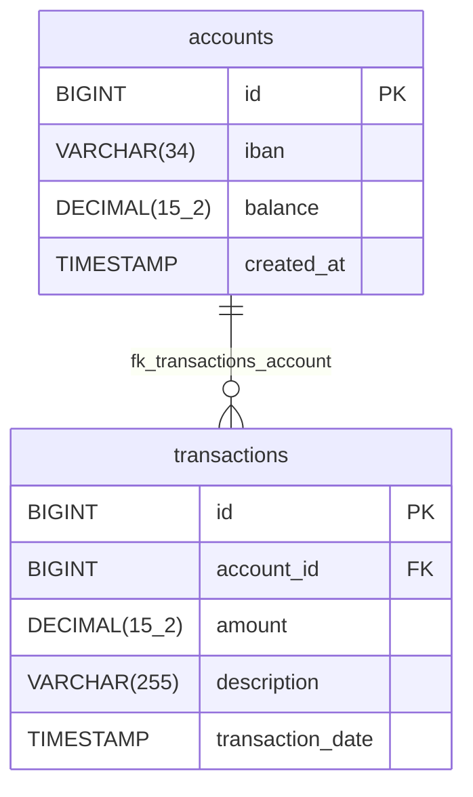

# 🗄️ Veritabanı Şema Dokümantasyonu

> **Motor (Dialect):** `Liquibase`  
> **Toplam Tablo Sayısı:** `2`  
> **Oluşturulma Tarihi:** `2026-11-09 14:17:32 UTC`  
> *Bu dokümantasyon [SchemaFlow.ai](https://github.com) tarafından otomatik üretilmiştir.*

## 📑 İçindekiler
- [📊 İlişkisel ER Diyagramı](#-ilişkisel-er-diyagramı)
- [📋 Tablolar](#-tablolar)
  - [accounts](#accounts)
  - [transactions](#transactions)

## 📊 İlişkisel ER Diyagramı

## 📋 Tablolar

### `accounts`
*Banka Müşteri Hesapları*

#### Sütunlar
| Adı | Tipi | PK | Nullable | Varsayılan | Açıklama |
| :--- | :--- | :---: | :---: | :--- | :--- |
| **id** | `BIGINT` | ✅ | **Hayır** | — | — |
| **iban** | `VARCHAR(34)` | — | **Hayır** | — | — |
| **balance** | `DECIMAL(15,2)` | — | **Hayır** | `0.00` | — |
| **created_at** | `TIMESTAMP` | — | Evet | `CURRENT_TIMESTAMP` | — |

#### İndeksler
| İndeks Adı | Kolonlar | Tekil (Unique)? | Filtre |
| :--- | :--- | :---: | :--- |
| `UQ_accounts_iban` | `iban` | ✅ | — |
| `idx_accounts_iban` | `iban` | ✅ | — |

---

### `transactions`
*Hesap Hareketleri*

#### Sütunlar
| Adı | Tipi | PK | Nullable | Varsayılan | Açıklama |
| :--- | :--- | :---: | :---: | :--- | :--- |
| **id** | `BIGINT` | ✅ | **Hayır** | — | — |
| **account_id** | `BIGINT` | — | **Hayır** | — | — |
| **amount** | `DECIMAL(15,2)` | — | **Hayır** | — | — |
| **description** | `VARCHAR(255)` | — | Evet | — | — |
| **transaction_date** | `TIMESTAMP` | — | Evet | — | — |

#### İlişkiler (Foreign Keys)
| Kısıt Adı | Kolon | Hedef Tablo | Hedef Kolon | On Delete |
| :--- | :--- | :--- | :--- | :--- |
| `fk_transactions_account` | `account_id` | [accounts](#accounts) | `id` | `CASCADE` |

---