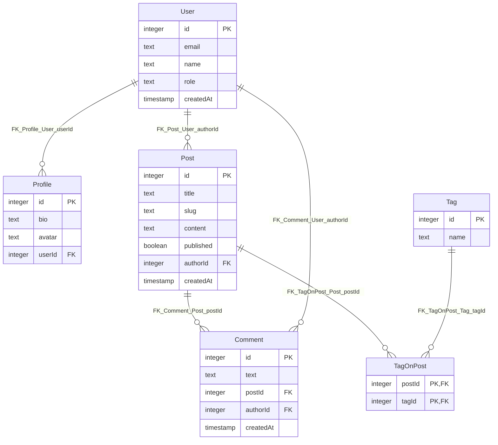

# 🗄️ Veritabanı Şema Dokümantasyonu

> **Motor (Dialect):** `Prisma`  
> **Toplam Tablo Sayısı:** `6`  
> **Oluşturulma Tarihi:** `2026-11-09 14:04:29 UTC`  
> *Bu dokümantasyon [SchemaFlow.ai](https://github.com) tarafından otomatik üretilmiştir.*

## 📑 İçindekiler
- [📊 İlişkisel ER Diyagramı](#-ilişkisel-er-diyagramı)
- [📋 Tablolar](#-tablolar)
  - [User](#user)
  - [Profile](#profile)
  - [Post](#post)
  - [Comment](#comment)
  - [Tag](#tag)
  - [TagOnPost](#tagonpost)

## 📊 İlişkisel ER Diyagramı

## 📋 Tablolar

### `User`
*Prisma Model*

#### Sütunlar
| Adı | Tipi | PK | Nullable | Varsayılan | Açıklama |
| :--- | :--- | :---: | :---: | :--- | :--- |
| **id** | `integer` | ✅ | **Hayır** | `autoincrement(` | — |
| **email** | `text` | — | **Hayır** | — | — |
| **name** | `text` | — | Evet | — | — |
| **role** | `text` | — | **Hayır** | `"user"` | — |
| **createdAt** | `timestamp` | — | **Hayır** | `now(` | — |

#### İndeksler
| İndeks Adı | Kolonlar | Tekil (Unique)? | Filtre |
| :--- | :--- | :---: | :--- |
| `UQ_User_email` | `email` | ✅ | — |

---

### `Profile`
*Prisma Model*

#### Sütunlar
| Adı | Tipi | PK | Nullable | Varsayılan | Açıklama |
| :--- | :--- | :---: | :---: | :--- | :--- |
| **id** | `integer` | ✅ | **Hayır** | `autoincrement(` | — |
| **bio** | `text` | — | Evet | — | — |
| **avatar** | `text` | — | Evet | — | — |
| **userId** | `integer` | — | **Hayır** | — | — |

#### İlişkiler (Foreign Keys)
| Kısıt Adı | Kolon | Hedef Tablo | Hedef Kolon | On Delete |
| :--- | :--- | :--- | :--- | :--- |
| `FK_Profile_User_userId` | `userId` | [User](#user) | `id` | `Cascade` |

#### İndeksler
| İndeks Adı | Kolonlar | Tekil (Unique)? | Filtre |
| :--- | :--- | :---: | :--- |
| `UQ_Profile_userId` | `userId` | ✅ | — |

---

### `Post`
*Prisma Model*

#### Sütunlar
| Adı | Tipi | PK | Nullable | Varsayılan | Açıklama |
| :--- | :--- | :---: | :---: | :--- | :--- |
| **id** | `integer` | ✅ | **Hayır** | `autoincrement(` | — |
| **title** | `text` | — | **Hayır** | — | — |
| **slug** | `text` | — | **Hayır** | — | — |
| **content** | `text` | — | Evet | — | — |
| **published** | `boolean` | — | **Hayır** | `false` | — |
| **authorId** | `integer` | — | **Hayır** | — | — |
| **createdAt** | `timestamp` | — | **Hayır** | `now(` | — |

#### İlişkiler (Foreign Keys)
| Kısıt Adı | Kolon | Hedef Tablo | Hedef Kolon | On Delete |
| :--- | :--- | :--- | :--- | :--- |
| `FK_Post_User_authorId` | `authorId` | [User](#user) | `id` | `NO ACTION` |

#### İndeksler
| İndeks Adı | Kolonlar | Tekil (Unique)? | Filtre |
| :--- | :--- | :---: | :--- |
| `UQ_Post_slug` | `slug` | ✅ | — |

---

### `Comment`
*Prisma Model*

#### Sütunlar
| Adı | Tipi | PK | Nullable | Varsayılan | Açıklama |
| :--- | :--- | :---: | :---: | :--- | :--- |
| **id** | `integer` | ✅ | **Hayır** | `autoincrement(` | — |
| **text** | `text` | — | **Hayır** | — | — |
| **postId** | `integer` | — | **Hayır** | — | — |
| **authorId** | `integer` | — | **Hayır** | — | — |
| **createdAt** | `timestamp` | — | **Hayır** | `now(` | — |

#### İlişkiler (Foreign Keys)
| Kısıt Adı | Kolon | Hedef Tablo | Hedef Kolon | On Delete |
| :--- | :--- | :--- | :--- | :--- |
| `FK_Comment_Post_postId` | `postId` | [Post](#post) | `id` | `Cascade` |
| `FK_Comment_User_authorId` | `authorId` | [User](#user) | `id` | `NO ACTION` |

---

### `Tag`
*Prisma Model*

#### Sütunlar
| Adı | Tipi | PK | Nullable | Varsayılan | Açıklama |
| :--- | :--- | :---: | :---: | :--- | :--- |
| **id** | `integer` | ✅ | **Hayır** | `autoincrement(` | — |
| **name** | `text` | — | **Hayır** | — | — |

#### İndeksler
| İndeks Adı | Kolonlar | Tekil (Unique)? | Filtre |
| :--- | :--- | :---: | :--- |
| `UQ_Tag_name` | `name` | ✅ | — |

---

### `TagOnPost`
*Prisma Model*

#### Sütunlar
| Adı | Tipi | PK | Nullable | Varsayılan | Açıklama |
| :--- | :--- | :---: | :---: | :--- | :--- |
| **postId** | `integer` | ✅ | **Hayır** | — | — |
| **tagId** | `integer` | ✅ | **Hayır** | — | — |

#### İlişkiler (Foreign Keys)
| Kısıt Adı | Kolon | Hedef Tablo | Hedef Kolon | On Delete |
| :--- | :--- | :--- | :--- | :--- |
| `FK_TagOnPost_Post_postId` | `postId` | [Post](#post) | `id` | `NO ACTION` |
| `FK_TagOnPost_Tag_tagId` | `tagId` | [Tag](#tag) | `id` | `NO ACTION` |

---