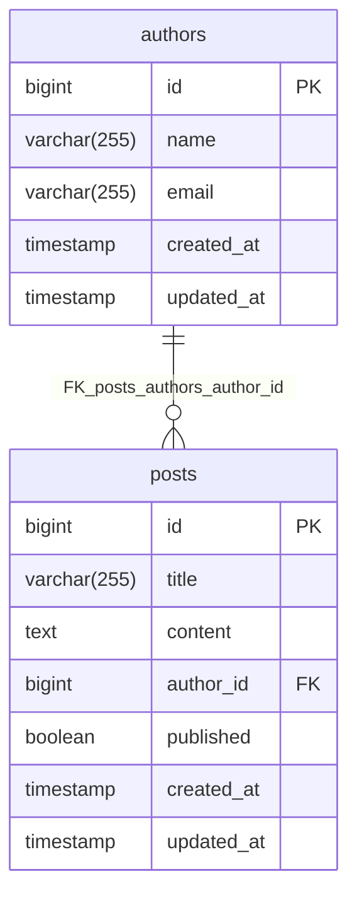

# 🗄️ Veritabanı Şema Dokümantasyonu

> **Motor (Dialect):** `Rails`  
> **Toplam Tablo Sayısı:** `2`  
> **Oluşturulma Tarihi:** `2026-11-09 14:21:58 UTC`  
> *Bu dokümantasyon [SchemaFlow.ai](https://github.com) tarafından otomatik üretilmiştir.*

## 📑 İçindekiler
- [📊 İlişkisel ER Diyagramı](#-ilişkisel-er-diyagramı)
- [📋 Tablolar](#-tablolar)
  - [authors](#authors)
  - [posts](#posts)

## 📊 İlişkisel ER Diyagramı

## 📋 Tablolar

### `authors`
*Ruby on Rails Model*

#### Sütunlar
| Adı | Tipi | PK | Nullable | Varsayılan | Açıklama |
| :--- | :--- | :---: | :---: | :--- | :--- |
| **id** | `bigint` | ✅ | **Hayır** | — | — |
| **name** | `varchar(255)` | — | **Hayır** | — | — |
| **email** | `varchar(255)` | — | **Hayır** | — | — |
| **created_at** | `timestamp` | — | **Hayır** | — | — |
| **updated_at** | `timestamp` | — | **Hayır** | — | — |

#### İndeksler
| İndeks Adı | Kolonlar | Tekil (Unique)? | Filtre |
| :--- | :--- | :---: | :--- |
| `index_authors_on_email` | `email` | ✅ | — |

---

### `posts`
*Ruby on Rails Model*

#### Sütunlar
| Adı | Tipi | PK | Nullable | Varsayılan | Açıklama |
| :--- | :--- | :---: | :---: | :--- | :--- |
| **id** | `bigint` | ✅ | **Hayır** | — | — |
| **title** | `varchar(255)` | — | **Hayır** | — | — |
| **content** | `text` | — | Evet | — | — |
| **author_id** | `bigint` | — | **Hayır** | — | — |
| **published** | `boolean` | — | Evet | `false` | — |
| **created_at** | `timestamp` | — | **Hayır** | — | — |
| **updated_at** | `timestamp` | — | **Hayır** | — | — |

#### İlişkiler (Foreign Keys)
| Kısıt Adı | Kolon | Hedef Tablo | Hedef Kolon | On Delete |
| :--- | :--- | :--- | :--- | :--- |
| `FK_posts_authors_author_id` | `author_id` | [authors](#authors) | `id` | `CASCADE` |

#### İndeksler
| İndeks Adı | Kolonlar | Tekil (Unique)? | Filtre |
| :--- | :--- | :---: | :--- |
| `index_posts_on_author_id` | `author_id` | — | — |

---